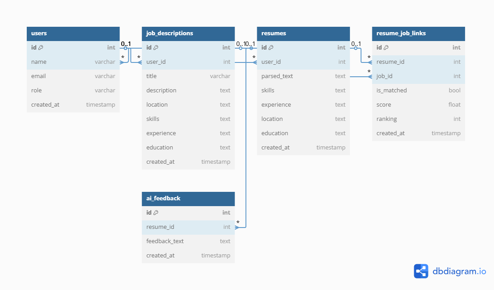

# AI Resume Screener

Matches resumes to job descriptions and ranks applicants. HR posts a job, applicants upload resumes, and the backend parses them, scores each one against the job, and ranks them.

<p>
  
  
  
  
  
</p>

**Status:** backend works end to end. Frontend has login and register only, the HR and applicant dashboards are next.

## How it works

1. **Parse**: extract text from the PDF (PyMuPDF), then pull out sections and skills either locally or with an LLM (Groq, Llama 3 8B).
2. **Score**: pull entities and key phrases with spaCy, embed them with Sentence-BERT (`all-MiniLM-L6-v2`), and compare against the resume's skills, experience and projects with cosine similarity.
3. **Rank**: sort applicants by score and mark them matched above a threshold.
4. **Feedback**: give each applicant a short feedback note based on their match score and rank.

## API

All routes are under `/api/v1`. Interactive docs are at `/docs`.

| Area | Endpoints |
|---|---|
| Auth | `POST /register` · `POST /login` (JWT) |
| Users | `GET /profile` |
| Jobs | `POST/GET /job-descriptions` · `GET/PUT/PATCH/DELETE /job-descriptions/{id}` |
| Resumes | `POST /upload-local` · `POST /upload-groq` · `GET/PATCH/DELETE /me/{id}` |
| Matching | `POST /link` · `DELETE /unlink` · `POST /update-matches` · `POST /generate-feedback/{resume_id}/{job_id}` |

## Database

PostgreSQL with SQLAlchemy and Alembic migrations.

<p align="center"></p>

## Run it

```bash
# 1. database
docker compose up -d                        # Postgres on :5435, pgAdmin on :5050

# 2. backend
pip install -r requirements.txt
python -m spacy download en_core_web_sm
cp .env.example .env                        # fill in the values
alembic upgrade head
uvicorn backend.app.main:app --reload       # http://localhost:8000/docs

# 3. frontend
cd frontend && npm install && npm run dev   # http://localhost:3000
```

## Structure

```
backend/app/
  api/v1/endpoints/   routes
  services/           parsing, ranking, matching, feedback
  models/ schemas/    SQLAlchemy models + Pydantic schemas
  core/               config, DB, security
alembic/              migrations
frontend/             Next.js (login, register)
```

## Next

- HR dashboard: post jobs, see ranked applicants
- Applicant dashboard: upload resume, see feedback
- LLM re-ranking of the top 5 and LLM-written feedback

Built with [HTG33](https://github.com/HTG33).
